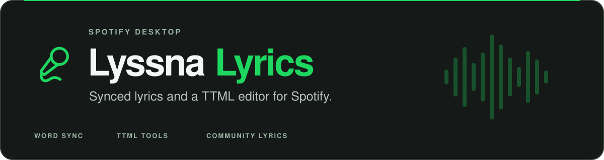

<div align="center">



<p>
  <a href="#install"></a>
  <a href="https://lyssna.org/guides"></a>
  <a href="https://discord.gg/qfYAsFQawp"></a>
</p>

**[Explore features](#features) · [Create and share lyrics](#create-and-share-lyrics) · [Releases](https://github.com/LyssnaHQ/lyssna-lyrics/releases) · [Lyssna for Windows](https://lyssna.org/lyssna_setup.exe)**

</div>

Lyssna Lyrics brings word-synced lyrics and a TTML editor to Spotify Desktop. Open it from the microphone in your playbar to follow a song, check your own sync, or share timed lyrics with the Lyssna community.

## Features

| | What you can do |
| :-- | :-- |
| **Synced lyrics** | Follow words or lines, read translations and romanization, and click a line to seek. Duet alignment and backing vocals follow the timing available for the track. |
| **Lyrics wherever you listen** | Use Spotify’s main view, Now Playing sidebar, fullscreen, or Cinema. Open a floating pop-out on clients that support it. |
| **Artwork and effects** | Choose animated, static, or artwork-based backgrounds. Show Spotify Canvas or an Apple Music animated cover when available. Try Space Gravity, Highlighter, or a custom animator preset. |
| **Personal layout** | Set lyric and interface fonts, timing offsets, and pinned credits. Enable Liquid Glass for settings and pin your favorite effects to the lyrics toolbar. |
| **Your lyric sources** | Play approved community lyrics from Lyssna, load your own timed files, and manage source priority in **Settings › Sources › Manage Sources**. |
| **Spotify enhancements** | Copy clean links, track IDs, song names, and ISRCs. Customize the share menu, device picker, playlist picker, and playbar buttons. |

## Install

### Spicetify

Open **Spicetify Marketplace › Extensions**, search for **Lyssna Lyrics**, and choose **Install**. [Spicetify Marketplace guide](https://spicetify.app/docs/customization/marketplace)

<details>
<summary>Install manually</summary>

1. Set up [Spicetify](https://spicetify.app/docs/getting-started) with Spotify Desktop.
2. Save [`lyssna-lyrics.mjs`](https://ipixelgalaxy.com/lyssna-plugin/rewrite/lyssna-lyrics.mjs) into Spicetify’s **Extensions** folder. Run `spicetify config-dir` to find it.
3. Enable the loader and apply Spicetify. Spotify may restart.

   ```sh
   spicetify config extensions lyssna-lyrics.mjs
   spicetify apply
   ```

</details>

Click the **microphone** in the playbar to open lyrics. Use the **gear** in the lyrics toolbar or **Lyssna Lyrics settings** in Spotify’s profile menu. [Spicetify extension guide](https://spicetify.app/docs/customization/extensions)

### SpotiKit

Build the project, then copy [the packaged extension](#build-and-maintain) from `dist/spotikit` into SpotiKit’s **Extensions** folder. The lyrics button appears in the playbar or top bar, depending on the client.

<details>
<summary>Fullscreen, Cinema, and uninstall</summary>

- **Fullscreen** fills the display. Use the playbar or lyrics toolbar button, or press <kbd>F11</kbd> in the lyrics view. Hold <kbd>Shift</kbd> when opening fullscreen to use Cinema inside Spotify.
- **Cinema Lyrics Window** opens a separate resizable window. Run `spicetify enable-devtools`, enable **Cinema Lyrics Window** in **Settings › Layout**, then use its playbar button.
- **Uninstall from Spicetify** by running `spicetify config extensions lyssna-lyrics.mjs-` and `spicetify apply`. You can then remove the loader file from **Extensions**.

</details>

## Create and share lyrics

### Time a sync in Spotify

1. Enable **TTML Creator** in **Settings › Advanced**, then click the editor button beside fullscreen in the playbar.
2. Start from the current lyrics, import a file, or paste your own text. Time words and syllables against the waveform or spectrogram. The editor supports duet lines, backing vocals, translations, and romanization.
3. Use **Show preview** and return to the lyrics view to check the draft with the song. Use **Reviewer mode** in the preview bubble to check timing with default lyric rendering and your chosen artwork and layout.
4. Choose **Use for this song** to save the sync locally, or copy or export the TTML. Creator keeps autosaved drafts and earlier versions in **Saves**.

On supported clients, share Spotify audio to capture a spectrogram and replay recorded sections at a different speed. You can also open a local audio file for timing. See how much space saved audio, spectrograms, and animated covers use under **Advanced › Manage Stored Data**.

### Submit a song’s lyrics to Lyssna

1. Open **Settings › Advanced › Lyssna Account** and choose **Sign in**. Approve the connection in your browser, then paste the sign-in result into Spotify and choose **Connect**. Confirm your email on Lyssna before submitting.
2. Play the Spotify song that matches your sync. Choose **Submit to Lyssna** from Creator once the timing is complete. If you already have a `.ttml` or `.xml` file, Uploaders and higher roles can submit it through **Load TTML › Submit to Lyssna**.
3. Lyssna links the submission to the Spotify track and includes its ISRC when available. Submissions from Uploaders and higher roles go live automatically. Other submissions wait for review. Once approved, the sync and its contributor credits are available through the **Lyssna Lyrics** source.

[Lyssna account](https://lyssna.org/account) · [Lyssna guides](https://lyssna.org/guides)

### Load or review a file locally

Open **Load TTML** in the lyrics toolbar. Lyssna accepts TTML, XML, and LRC for local playback.

| Load option | Duration |
| :-- | :-- |
| **Temporary Load** | Current song, until lyrics reload. |
| **Session Load** | That song, until Lyssna restarts. |
| **Persistent Load** | Saved for the song across restarts. |

Use **Bulk Load** to match multiple files to songs and **TTML Database** to find, download, or remove saved files. **TTML Reviewer** is available from the same menu for checking temporary imports or applying review settings throughout the lyrics view.

## Updates and support

The loader follows the channel selected in **Settings › Advanced › Build Channel**. Stable comes from GitHub Releases. Beta, Canary, and private builds are hosted on ipixelgalaxy.com.

If you received a private build key, paste it under **Hidden build key** and choose **Apply and reload**. **Remove key** returns to your public channel. Public builds show a notice when an update is available.

For help, include the build channel, version, Spotify client, and what you were doing. For lyric timing issues, include the track link and the affected line or timestamp. [Discord](https://discord.gg/qfYAsFQawp) · [GitHub issues](https://github.com/LyssnaHQ/lyssna-lyrics/issues)

Use **Advanced › Import and export settings** to transfer compatible preferences, animator presets, per-song offsets, and saved lyrics between Lyssna Lyrics and Lyssna for Windows.

## Build and maintain

<details>
<summary>Local build, publishing, and update previews</summary>

Install Node.js LTS and build the extension with npm.

```sh
npm ci
npm run build
```

The versioned bundle is in `dist/builds`. The build also produces the v1.0 entrypoint and the SpotiKit package.

- **Stable** uses the latest public [GitHub Release](https://github.com/LyssnaHQ/lyssna-lyrics/releases). Attach `lyssna-lyrics@<version>.mjs` to a matching `v<version>` release. The loader checks the asset against GitHub’s SHA-256 digest.
- **Beta and Canary** use `rewrite/v1.0/channels.json` on ipixelgalaxy.com. Run `npm run build -- --test` to deploy Canary to `Y:/website/lyssna-plugin`. For Beta, place the bundle under `builds/` and set the manifest’s `beta` version.
- **Private builds** use `npm run build -- --hidden [version]`. The command publishes to `builds/hidden/<key>/` and prints its access key. Anyone with the key can load the build. Keep the directory unlisted and remove a build’s manifest and bundle to retire its key.

Add user-visible changes to [PATCH_NOTES.md](.change_notes/PATCH_NOTES.md) under a heading like `## v0.1.0`. Use these Spotify DevTools commands to preview the dialogs.

```js
LyssnaLyrics.showStartup()
LyssnaLyrics.showFirstLoad()
LyssnaLyrics.showUpdateAvailable()
LyssnaLyrics.showUpdatedDialog()
```

Run `npm run sync:app` to import the renderer from the neighboring `lyssna-app` checkout. To sync a specific revision, run `npm run sync:app -- ../lyssna-app <commit>`. [Renderer source revision](src/lyssna/UPSTREAM)

</details>

## Credits and license

- **iPixelGalaxy** maintains Lyssna Lyrics. [GitHub](https://github.com/iPixelGalaxy)
- **Arashii** and the Lyssna contributors developed the desktop renderer and editor shared with the extension. [Lyssna](https://lyssna.org)
- **Fraktality** developed the spring model used in the lyric animator. [spr](https://github.com/Fraktality/spr)
- **Better Lyrics** provides Kawarp, which animates artwork backgrounds.
- **Lucide** provides the microphone and interface icons. Font and library licenses ship with the build. [Third-party notices](THIRD_PARTY_NOTICES.md)

Lyssna Lyrics is licensed under the **GNU Affero General Public License v3.0**. [License](LICENSE)
